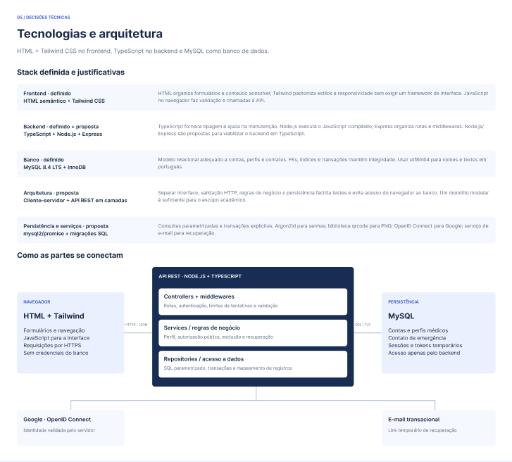
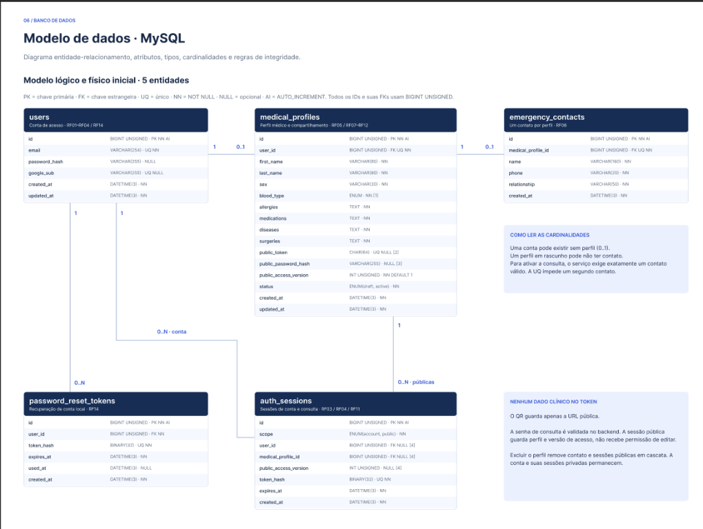

# VitalHelp

## Visão geral

VitalHelp é uma aplicação web para cadastro de perfil médico e consulta emergencial protegida por código. O backend é uma API REST em TypeScript com persistência MySQL; o frontend atual usa HTML, JavaScript e Tailwind CSS.

## Arquitetura do projeto

- **Frontend:** HTML, JavaScript e Tailwind CSS em `frontEnd/`.
- **Backend:** TypeScript, Node.js e Express. `backEnd/server.ts` expõe os endpoints HTTP, `backEnd/services/` contém regras de negócio, e `backEnd/repositories/database.ts` concentra o acesso ao MySQL.
- **Persistência:** MySQL 8.4/InnoDB com migração SQL versionada em `backEnd/migrations/001_initial_schema.sql`. A API aplica a migração inicial ao iniciar.
- **Autenticação:** login por e-mail/senha ou Google OpenID Connect; sessões opacas em cookies HttpOnly de duas horas. Só o hash SHA-256 do token é persistido, e logout remove a sessão.

O backend separa regras de domínio em serviços e consultas/mutações MySQL em repositórios. Os handlers HTTP ainda ficam concentrados em `backEnd/server.ts`; separar rotas e controllers é uma melhoria planejada.

## Modelo de dados

O modelo relacional contém cinco entidades de negócio — `users`, `medical_profiles`, `emergency_contacts`, `password_reset_tokens` e `auth_sessions` — com chaves estrangeiras, índices únicos e exclusão em cascata. `schema_migrations` é uma tabela técnica adicional para controlar as migrações aplicadas. `name` em `users` facilita a experiência de cadastro; `date_of_birth` em `medical_profiles` é necessário para o formulário atual.

As senhas da conta e de consulta usam Argon2id. Dados clínicos são criptografados com AES-256-GCM antes de serem armazenados. O QR guarda apenas um identificador opaco; o acesso público exige senha, usa uma sessão de duas horas separada da sessão da conta e é invalidado quando o perfil ou o código muda.

## Executar localmente

1. Copie `.env.example` para `.env` se ainda não existir. Preserve `GOOGLE_CLIENT_ID` e `SESSION_SECRET` já configurados; use senhas locais fortes e diferentes para `MYSQL_PASSWORD` e `MYSQL_ROOT_PASSWORD`.
2. Use `MYSQL_DATABASE=vitalhelp_v2`. Esta versão inicia um banco novo e não migra os dados da versão SQLite anterior.
3. No Google Cloud Console, configure a tela de consentimento OAuth e crie um OAuth Client ID do tipo **Aplicativo da Web**.
4. No OAuth Client ID, adicione `http://127.0.0.1:5173` e `http://localhost:5173` em **Origens JavaScript autorizadas** e configure `GOOGLE_CLIENT_ID` no `.env`. São origens diferentes: abra o app usando exatamente uma delas, incluindo a porta `5173`.
5. Gere `SESSION_SECRET` com `openssl rand -base64 32`. Não compartilhe esse segredo.
6. Inicie o MySQL com `docker compose up -d mysql` e aguarde até `docker compose ps` indicar que está saudável.
7. Execute `npm run dev` na raiz e abra `http://127.0.0.1:5173`. A API TypeScript é executada em modo watch. Para validar o frontend e compilar a API, use `npm run build`.

Para consultar pelo celular durante o desenvolvimento, conecte o celular e o computador à mesma rede Wi-Fi e permita conexões nas portas 5173 e 3000 no firewall. Se a detecção automática escolher o IP incorreto, configure `PUBLIC_FRONTEND_URL` no `.env`, por exemplo `http://192.168.1.25:5173`, e reinicie o servidor.

## API

- `GET /api/config`
- `POST /api/auth/signup`, `POST /api/auth/login` e `POST /api/auth/google`
- `GET /api/me`, `POST /api/logout` e `DELETE /api/account`
- `GET /api/profile` e `PUT /api/profile`
- `POST /api/consultation-password/generate` e `GET /api/qr`
- `POST /api/public/:publicId/unlock` e `GET /api/public/:publicId/profile`
- `POST /api/public/logout`

A consulta pública exige a senha de consulta e é somente leitura. O código QR só é liberado quando o perfil está completo e a senha de consulta foi configurada.

## Testes

- `npm run test:unit`: testes unitários de completude do perfil, criptografia e hashing Argon2id; não exigem MySQL.
- `npm run test:integration`: testes HTTP e MySQL. Exigem MySQL local ativo e `MYSQL_ROOT_PASSWORD` ou `MYSQL_TEST_PASSWORD` no `.env`.
- `npm test`: compila o backend e executa as duas suítes; requer o MySQL local para a integração.

Os testes de integração criam um banco temporário com nome aleatório e o removem ao final. Eles recusam hosts não locais e não devem ser executados contra produção.

## Implantação com Docker

Inicie o MySQL com `docker compose up -d mysql`; para executar frontend e API localmente, use `npm run dev`. Para iniciar a aplicação empacotada, execute `docker compose up -d --build app` e abra `http://127.0.0.1:3000`. O Compose usa o volume `vitalhelp_mysql_v2`.

## Limitações e segurança

Esta implementação é para desenvolvimento e demonstração, não para armazenar dados reais de saúde ou publicar em produção sem revisão. Antes de usar dados reais, faça uma revisão de segurança e LGPD, configure HTTPS, gestão e backup de chaves, controles de acesso, monitoramento e recuperação de dados. Recuperação de senha e envio transacional de e-mail ainda não estão implementados; a tabela `password_reset_tokens` já está prevista para essa evolução.
